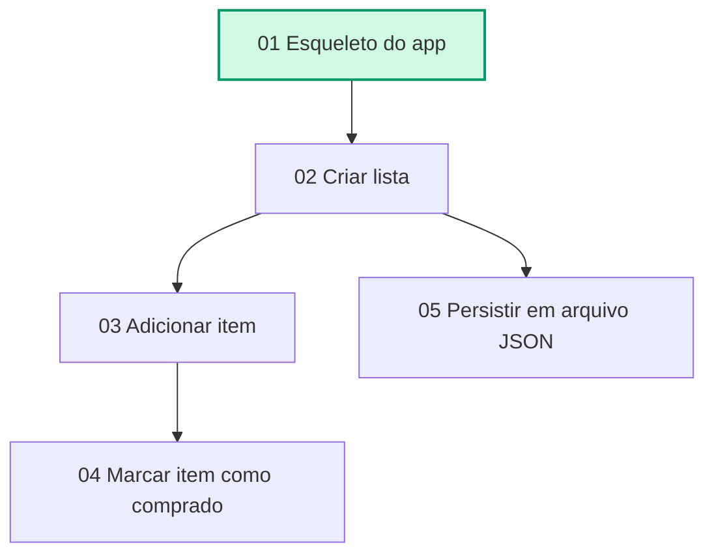

# 🛒 Roteiro — Do zero ao app com as skills do Matt Pocock

> **Cenário:** _"Uma equipe está desenvolvendo um aplicativo de lista de compras que permitirá aos usuários criarem e gerenciarem listas para organizar suas compras no mercado."_
>
> Vocês **são** essa equipe. Em grupo de 5, vão levar a ideia até código rodando passando por quatro skills, nesta ordem:
>
> **`/grill-with-docs` → `/to-spec` → `/to-tickets` → `/implement`**

Cada grupo vai ter um grilling diferente, e é isso que se espera. Não existe "resposta certa" para o app; o que importa é a qualidade das decisões e o caminho entre elas.

---

## ⏱️ Cronograma

| Horário       | Etapa                                    | Quem              |
| ------------- | ---------------------------------------- | ----------------- |
| 13:20 – 13:30 | Recapitulação das skills                 | Professor         |
| 13:30 – 13:40 | **0. Setup** (Codespace, skills)         | Grupo             |
| 13:40 – 14:00 | **1. Grilling** — `/grill-with-docs`     | Grupo             |
| 14:00 – 14:08 | **2. Spec** — `/to-spec`                 | Grupo             |
| 14:08 – 14:15 | **3. Tickets + DAG** — `/to-tickets`     | Grupo             |
| 14:15 – 14:40 | **4. Implementação** — `/implement`      | Grupo             |
| 14:40 – 15:00 | Questionário                             | Individual        |

## 👥 Papéis no grupo

O grupo trabalha em **um único Codespace** (aberto por uma pessoa), todos olhando a mesma tela.

Cada pessoa assume **um papel diferente**, como numa equipe de verdade. Não repitam papéis: cada um tem algo próprio para contribuir.

| Papel                       | Contribui com…                                                        |
| --------------------------- | --------------------------------------------------------------------- |
| **Product Owner**           | O que entra ou não no app e o que é prioridade. Desempata discussões. |
| **Especialista de domínio** | Como as pessoas fazem compras no mercado de verdade.                  |
| **Engenheiro de software**  | Viabilidade técnica, dados e como quebrar o trabalho em tickets.      |
| **Designer (UX)**           | Como o usuário vai usar as telas, para que fique simples.             |
| **QA (qualidade)**          | Casos de erro e de borda, e se o app faz o que a spec diz.            |

Além do papel:

- **Driver** — é quem digita no Copilot. **O teclado troca de mão a cada etapa** (grilling, spec, tickets, implement).
- **Guardião do tempo** — a pessoa que não está pilotando em nenhuma etapa. Vigia o cronograma acima e avisa quando é hora de encerrar a etapa.
- **Todos** — respondem as perguntas do grilling em voz alta, cada um pela ótica do seu papel. O driver só digita o que o grupo decidiu.

---

## 0. Setup (13:30 – 13:40)

### 0.1 Abrir o Codespace

**Uma pessoa do grupo** clica, no topo desta página, em **Code → Codespaces → Create codespace on main**.

> 💡 Não é preciso fazer fork nem ligar Issues. A spec e as issues serão **arquivos markdown locais**, na pasta `.scratch/` do próprio Codespace.

### 0.2 Copilot no modo certo

1. Abra o **Copilot Chat** (ícone do Copilot na barra lateral, ou `Ctrl+Alt+I`).
2. No seletor de modo, escolha **Agent**.
3. No seletor de modelo, escolha **o melhor modelo Claude disponível** no seu plano (ex.: Claude Sonnet). Modelos mais fracos seguem mal as skills longas.

### 0.3 Instalar as skills no lugar certo

O Copilot procura skills de projeto em **`.github/skills/<nome-da-skill>/SKILL.md`**. Cada skill é uma pasta; o nome da pasta vira o comando `/nome` no chat.

Vamos instalar **só as 9 skills** que este fluxo usa. As 4 etapas chamam outras skills por baixo: o `grill-with-docs` usa o `grilling` e o `domain-modeling`, e o `implement` usa o `tdd` e o `code-review`. O `setup-matt-pocock-skills` configura o repositório.

Cole no **terminal do Codespace** (`` Ctrl+` ``):

```bash
git clone -q https://github.com/mattpocock/skills /tmp/mp-skills
git -C /tmp/mp-skills checkout -q 5863806dd4e15c63174bee4e7515a4256792ecfa
mkdir -p .github/skills
for s in productivity/grilling \
         engineering/grill-with-docs engineering/domain-modeling \
         engineering/setup-matt-pocock-skills engineering/to-spec engineering/to-tickets \
         engineering/implement engineering/tdd engineering/code-review; do
  cp -r "/tmp/mp-skills/skills/$s" .github/skills/
done
ls .github/skills
```

Saída esperada (9 pastas):

```
code-review  domain-modeling  grill-with-docs  grilling  implement  setup-matt-pocock-skills  tdd  to-spec  to-tickets
```

> 💡 Se `/grill-with-docs` não aparecer quando você digitar `/` no chat: `Ctrl+Shift+P` → **Developer: Reload Window**.

### 0.4 Configurar o repositório para as skills

As skills precisam saber **onde ficam as issues**. Nesta aula elas ficam em **arquivos markdown locais** (pasta `.scratch/`), e não nas Issues do GitHub. Essa escolha já vai no prompt.

No **Copilot Chat**, cole exatamente assim:

```
/setup-matt-pocock-skills Já está tudo decidido. Não precisa perguntar nem pedir confirmação do rascunho, pode escrever direto:
- Issue tracker: Local markdown. A spec e as issues ficam em arquivos markdown locais em .scratch/. NÃO use o GitHub Issues nem o gh, mesmo que o git remote aponte para o GitHub.
- Domain docs: single-context.
- Arquivo a editar: AGENTS.md (já existe neste repositório).
- Acrescente em docs/agents/issue-tracker.md como fechar uma issue: ao concluir, marque os critérios de aceite com [x] e troque a linha Status para "done".
Responda em português.
```

Ao final, confiram que existe o arquivo `docs/agents/issue-tracker.md` falando em **Local Markdown** e que o `AGENTS.md` ganhou a seção `## Agent skills`.

### 0.5 Salvar o setup

```bash
git add -A && git commit -m "Setup das skills"
```

> 💡 O commit é só local. Não é preciso `git push`: todo o trabalho da aula fica no Codespace.

✅ **Checklist do setup:** Codespace aberto ✔ · Agent mode + Claude ✔ · 9 skills em `.github/skills` ✔ · `/setup-matt-pocock-skills` com issues locais ✔ · commit ✔

---

## 1. Grilling (13:40 – 14:00)

🎯 **Objetivo:** o agente entrevista o grupo até vocês terem decidido **o que** é o app. Ele faz as perguntas em rodadas e traz uma recomendação em cada uma. Vocês podem aceitar, recusar ou discutir. Conforme vocês respondem, ele registra os termos do domínio em `GLOSSARY.md` e, só quando a decisão for difícil de reverter, propõe um ADR em `docs/adr/`.

**Prompt inicial** — cole no chat, exatamente assim:

```
/grill-with-docs Uma equipe está desenvolvendo um aplicativo de lista de compras que permitirá aos usuários criarem e gerenciarem listas para organizar suas compras no mercado. Nós somos essa equipe (um grupo de 5 respondendo junto) e o repositório ainda não tem código.

Restrições já decididas — NÃO precisam ser discutidas:
- Stack: Python + Flask, com HTML renderizado no servidor (templates Jinja2), + pytest para testes. O app fica na pasta app/ (entrada em app/app.py, dependências em app/requirements.txt).
- Persistência só em um arquivo JSON local, dentro da pasta app/. Sem banco de dados, sem login.
- As regras de negócio das listas ficam num módulo separado da interface, testável sem Flask nem HTTP.
- Interface simples porém bonita: CSS próprio, mobile-first, sem biblioteca de UI e sem framework JavaScript.

Temos cerca de 20 minutos de grilling. Priorize as decisões de maior impacto no produto e na experiência do usuário (o que é uma lista, o que é um item, o que o usuário consegue fazer com eles, o que aparece na tela e como) e deixe detalhes cosméticos para o fim. Responda em português.
```

**Dicas para o grupo:**
- Discutam antes de responder. "Sim" aceita a recomendação do agente.
- Pode responder várias perguntas de uma vez: `Q1 sim, Q2 não — queremos X, Q3 sim`.
- Não sabem responder? Peçam: `explique as opções da Q3 com um exemplo`.

⏰ **Às 14:00**, mesmo que o agente ainda tenha perguntas, digite o comando abaixo e NÃO FECHE A SESSÃO E NÃO USE O COMANDO /clear!!

```
Vamos encerrar o grilling aqui. Liste as decisões que tomamos e assuma suas recomendações para o que ficou em aberto.
```

---

## 2. Spec (14:00 – 14:08)

🎯 **Objetivo:** transformar a conversa numa spec salva como **arquivo markdown local**, em `.scratch/lista-de-compras/spec.md`.

> ⚠️ **Use o mesmo chat** do grilling. A spec é escrita a partir do que vocês conversaram.

```
/to-spec Escreva a spec em português, a partir das decisões do grilling acima. As seams de teste devem ficar no módulo de regras das listas (sem Flask nem HTTP). Salve a spec em .scratch/lista-de-compras/spec.md.
```

O agente vai confirmar as seams de teste com vocês e depois criar o arquivo.

📝 **Abram o `.scratch/lista-de-compras/spec.md`** (`Ctrl+Shift+V` mostra o preview) e confiram se ele reflete o que o grupo decidiu. Ele vai ser usado nas próximas etapas.

---

## 3. Tickets + DAG (14:08 – 14:15)

🎯 **Objetivo:** quebrar a spec em tickets verticais (cada um entrega algo que funciona de ponta a ponta) e **enxergar as dependências** entre eles como um **grafo direcionado acíclico (DAG)**.

> Por que um DAG? Cada ticket diz quais outros o **bloqueiam**. Se desenharmos "A bloqueia B" como uma seta `A → B`, o resultado tem que ser um grafo **sem ciclos**. Um ciclo significaria que nenhum dos tickets envolvidos consegue começar. Os nós sem setas chegando formam a **fronteira**: é o que dá para implementar agora.

Cada ticket vira **uma issue local**: um arquivo em `.scratch/lista-de-compras/issues/`, numerado a partir de `01` (ex.: `01-esqueleto-do-app.md`).

````
/to-tickets Quebre a spec em .scratch/lista-de-compras/spec.md em tickets, escritos em português. Temos só ~25 minutos de implementação: mire em 4 a 7 tickets pequenos, sendo o primeiro o esqueleto do app (Flask + pytest em app/, com app/app.py e app/requirements.txt, página inicial vazia e um teste passando).

Depois de criar os arquivos das issues em .scratch/lista-de-compras/issues/, monte o grafo direcionado acíclico (DAG) das dependências em Mermaid:
- use `graph TD`, com um nó por issue rotulado "NN título curto" (NN é o número do arquivo da issue);
- desenhe uma aresta A --> B quando A bloqueia B (a seta vai de quem bloqueia para quem é bloqueado);
- confira que não há ciclos; se houver, corrija o "Blocked by" das issues antes de desenhar;
- destaque com classDef os nós da fronteira (sem bloqueios em aberto), que podem começar já.

Salve o grafo em .scratch/lista-de-compras/dag.md, dentro de um bloco ```mermaid, e mostre o mesmo grafo aqui no chat.
````

O agente vai propor a quebra e perguntar se a granularidade e os bloqueios estão certos. **Discutam antes de aprovar.**

👀 Depois, abram a pasta `.scratch/lista-de-compras/issues/` e leiam as issues criadas. O grafo fica em `.scratch/lista-de-compras/dag.md`. Se ele aparecer só como código, colem o bloco em [mermaid.live](https://mermaid.live) para vê-lo desenhado. Exemplo do formato esperado:



---

## 4. Implementação (14:15 – 14:40)

🎯 **Objetivo:** implementar issues **seguindo o DAG**: comecem pela fronteira e sigam as setas.

> 💡 **Abram um chat novo** (`+` no Copilot Chat) para implementar. As issues e a spec já têm tudo o que o agente precisa, e um contexto limpo trabalha melhor.

### Uma issue

```
/implement a issue 01 de .scratch/lista-de-compras/issues/
```

### Várias issues — **sempre em sequência, nunca em paralelo**

Listem as issues **na ordem do DAG** (quem bloqueia vem antes):

```
/implement as issues 01, 02 e 03 de .scratch/lista-de-compras/issues/

Implemente essas issues UMA DE CADA VEZ, na ordem em que estão listadas. Regras:
1. Antes de começar, confira a ordem com o DAG em .scratch/lista-de-compras/dag.md: cada issue só pode vir depois de todas as que a bloqueiam (já com Status "done" ou listadas antes dela). Se a ordem violar o DAG, pare e me diga.
2. Para cada issue: Crie um subagente que irá ler o arquivo da issue → diga o título → implemente com TDD → rode os testes até passarem → marque os critérios de aceite com [x] e troque o Status da issue para "done" → faça commit com a mensagem "<título da issue> (issue NN)" → encerre o subagente → só então o coordenador começa a próxima.
3. Nada em paralelo: subagentes estão liberados, porém não trabalhe em duas issues ao mesmo tempo.
4. Pule o code-review no final (estamos com o tempo curto).
5. Se uma issue travar, pare e me avise. Não pule para a próxima.
```

### Ver o app rodando

```bash
cd app && pip install -r requirements.txt && python -m flask run --debug
```

O Codespace vai oferecer **Open in Browser** para a porta 5000. Se não oferecer, use a aba **Ports**.

Para rodar os testes: `cd app && python -m pytest`.

### Acompanhando o progresso

- Cada issue concluída fica com `Status: done` e os critérios de aceite marcados com `[x]` no próprio arquivo. Para ver o placar no terminal:

  ```bash
  grep -H "Status:" .scratch/lista-de-compras/issues/*.md
  ```

- Voltem ao DAG: a cada issue fechada, a fronteira avança. O que dá para implementar agora?

⏰ **Às 14:40** parem onde estiverem e façam commit (`git add -A && git commit -m "Fim da aula"`). O que não ficou pronto continua como issue aberta, e isso faz parte do resultado.

---

## 🧯 Problemas comuns

| Sintoma | Solução |
| --- | --- |
| `/grill-with-docs` não aparece no `/` | Confira se a pasta existe em `.github/skills/grill-with-docs/SKILL.md` → **Developer: Reload Window**. |
| Agente diz que não tem "Skill tool" para chamar o `grilling` e o `domain-modeling` | Use `/grilling` direto com o mesmo prompt inicial e acrescente no fim: "siga também a skill em `.github/skills/domain-modeling/SKILL.md`". |
| `/to-spec` pede para rodar `/setup-matt-pocock-skills` | O passo 0.4 não foi feito. Rodem de novo. |
| Agente tenta usar o `gh` ou criar issue no GitHub | Digam: "o issue tracker é local markdown, veja `docs/agents/issue-tracker.md`". Se esse arquivo não existir, refaçam o passo 0.4. |
| Agente quer discutir framework/banco de dados | Lembre: "a stack já está decidida no prompt inicial". |

---

## 📚 Referências

- Skills: [mattpocock/skills](https://github.com/mattpocock/skills) (commit `5863806`)
- [Agent Skills no VS Code / Copilot](https://code.visualstudio.com/docs/copilot/customization/agent-skills)
- [Mermaid Live Editor](https://mermaid.live), para ver o DAG desenhado
